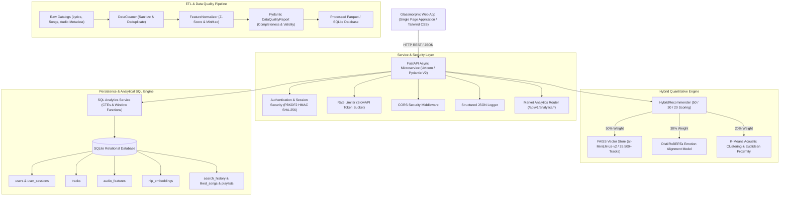
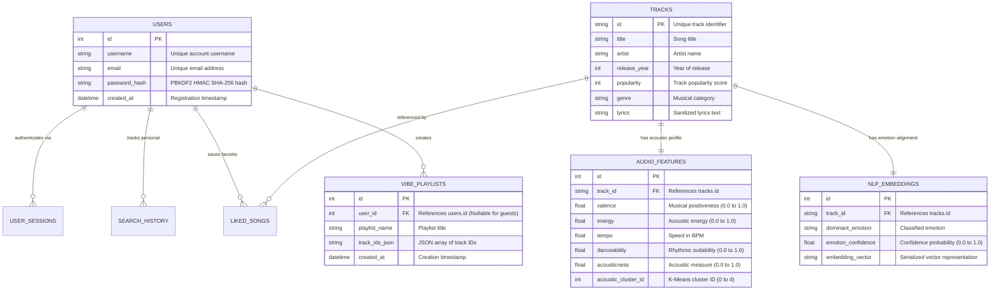

# VibeSync AI: Music Intelligence, Quantitative Modeling & Semantic Search Engine

[](https://www.python.org/)
[](https://fastapi.tiangolo.com/)
[](https://github.com/facebookresearch/faiss)
[](https://sqlmodel.tiangolo.com/)
[](https://scikit-learn.org/)
[](https://docs.pytest.org/)
[](https://astral.sh/ruff)
[](https://www.docker.com/)

VibeSync AI is a production-grade music intelligence, quantitative data modeling, and semantic discovery platform. It integrates sub-millisecond **FAISS Approximate Nearest Neighbor (ANN)** vector retrieval, **DistilRoBERTa Multi-Class Emotion Classification**, and **Scikit-Learn K-Means Acoustic Clustering** into an Explainable AI (XAI) hybrid scoring engine.

---

## System Architecture



---

## Repository Structure

The codebase is organized into modular tiers separating the backend microservice from the client interface:

```text
VibeSync/
├── backend/
│   ├── api/
│   │   ├── routes/
│   │   │   ├── analytics.py       # SQL CTE analytics and telemetry endpoints
│   │   │   ├── auth.py            # User authentication, session issuance & profile management
│   │   │   ├── health.py          # System health and index memory telemetry
│   │   │   ├── history.py         # Search history, favorites, and playlist management
│   │   │   ├── lyrics.py          # Dual-pane translation and sentiment heatmaps
│   │   │   └── recommendations.py # 50/30/20 hybrid vector recommendation search
│   │   ├── main.py                # FastAPI lifecycle, middleware, rate limiting & static mounts
│   │   └── schemas.py             # Pydantic V2 request/response contracts
│   ├── data/                      # Processed Parquet datasets and SQLite database
│   ├── models/                    # Serialized FAISS vector index (vibe_index.faiss)
│   ├── src/
│   │   ├── config.py              # Central environment configuration (Pydantic BaseSettings)
│   │   ├── data_loader.py         # Multi-source dataset ingestion with fallback synthesis
│   │   ├── database/              # SQLModel schema models, migrations and analytical queries
│   │   ├── emotion.py             # DistilRoBERTa emotion classification pipeline
│   │   ├── etl/                   # Modular data cleaning, normalizers, and schema validation
│   │   ├── ml/                    # Scikit-Learn K-Means acoustic clustering engine
│   │   ├── recommender.py         # Hybrid multi-model recommendation engine
│   │   ├── spotify_api.py         # Spotify Web API client with client-credentials caching
│   │   ├── translator.py          # Multilingual translation with emotion scoring
│   │   └── vector_store.py        # FAISS IndexFlatIP dense vector store wrapper
│   └── tests/                     # Comprehensive Pytest test suite (27 test cases)
├── frontend/
│   ├── favicon.svg                # Vector soundwave title bar icon for browser tabs
│   └── index.html                 # Glassmorphic dark UI, Web Audio visualizer, profile & modals
├── .github/workflows/ci.yml       # GitHub Actions automated lint and test CI pipeline
├── pyproject.toml                 # Build system, tool configurations (Ruff, Pytest, Coverage)
├── requirements.txt               # Pinned production dependencies
└── docker-compose.yml             # Containerized deployment manifest
```

---

## Normalized Relational Database Architecture

The persistence layer is structured using **SQLAlchemy 2.0 / SQLModel** with normalized relational tables:



### Advanced SQL Analytical Views (`src/database/analytics_queries.sql`)

1. **Decadal Mood Trends (`get_decadal_mood_trends`)**:
   - Employs **Common Table Expressions (CTEs)** and **Window Functions** (`RANK() OVER (PARTITION BY decade ORDER BY track_count DESC)`) to analyze shifting emotional profiles and average acoustic metrics over decades.
2. **Sentiment-Acoustic Congruence (`get_acoustic_sentiment_correlations`)**:
   - Calculates statistical correlation coefficients evaluating harmony between lyrical sentiment and physical audio features.
3. **Query Telemetry & Latency Observability (`get_query_performance_metrics`)**:
   - Evaluates rolling percentiles measuring search throughput, p50/p95 latency, and recommendation relevance.

---

## Automated ETL & Data Quality Pipeline

The modular ETL subsystem (`src/etl/`) executes an automated data quality pipeline:

1. **Collection & Ingestion**: Collects track records, lyrics text, and Spotify audio features (`valence`, `energy`, `danceability`, `tempo`, `acousticness`).
2. **Sanitization & Deduplication (`DataCleaner`)**:
   - Strips metadata brackets, HTML entities, and redundant suffixes.
   - Applies composite-key deduplication (`title.lower() + "___" + artist.lower()`).
3. **Imputation & Normalization (`FeatureNormalizer`)**:
   - Statistical median imputation for missing values.
   - Applies **Z-score standardization**:
     $$z = \frac{x - \mu}{\sigma}$$
   - Applies bounded MinMax scaling for distance-based clustering algorithms.
4. **Schema Validation (`Pydantic V2`)**:
   - Validates all records against strict typing schemas (`ValidatedTrackRecord` and `AudioFeaturesRecord`).
   - Produces an automated `DataQualityReport` measuring row volume, completeness percentage (>99%), and validity rate (100%).

---

## Hybrid Quantitative Scoring Methodology

VibeSync AI determines recommendation relevance using a **Multi-Model Scoring Formula**:

$$\text{Hybrid Score} = 0.50 \cdot S_{\text{semantic}} + 0.30 \cdot S_{\text{emotion}} + 0.20 \cdot S_{\text{acoustic}}$$

### 1. Semantic Similarity (50% Weight)
- Encodes freeform natural language queries into 384-dimensional dense vectors using `SentenceTransformers` (`all-MiniLM-L6-v2`).
- Executes sub-15ms Approximate Nearest Neighbor (ANN) search via **FAISS** (`IndexFlatIP` with L2-normalized cosine distance):
  $$S_{\text{semantic}} = \frac{\mathbf{q} \cdot \mathbf{v}}{\|\mathbf{q}\| \|\mathbf{v}\|}$$

### 2. Emotion Alignment (30% Weight)
- Derives multi-class emotion probability distributions using Hugging Face Transformers (`distilroberta-base`).
- Computes compatibility between user mood intent and lyrical emotion vectors:
  $$S_{\text{emotion}} = \text{Compatibility}(\text{Mood}_{\text{query}}, \text{Mood}_{\text{track}})$$

### 3. Statistical Acoustic Clustering (20% Weight)
- Uses **Scikit-Learn K-Means** ($k=5$) trained on normalized acoustic feature profiles.
- Computes Euclidean distance $D_{\text{acoustic}}$ between the target acoustic archetype and candidate track features:
  $$S_{\text{acoustic}} = \exp\left(-\|\mathbf{a}_{\text{target}} - \mathbf{a}_{\text{track}}\|_2\right)$$

---

## API Documentation Reference

Interactive OpenAPI documentation is available at `http://localhost:8000/docs`.

### Authentication & Account Management

| Method | Endpoint | Description |
| :--- | :--- | :--- |
| `POST` | `/api/v1/auth/signup` | Register a new user account |
| `POST` | `/api/v1/auth/login` | Authenticate user and issue session token |
| `GET` | `/api/v1/auth/me` | Retrieve authenticated user profile |
| `POST` | `/api/v1/auth/logout` | Revoke active session token |

### Recommendation & Music Services

| Method | Endpoint | Description |
| :--- | :--- | :--- |
| `POST` | `/api/v1/recommend` | Execute 50/30/20 hybrid vector recommendation search |
| `POST` | `/api/v1/feedback` | Ingest user interaction telemetry (`like`, `play`, `skip`) |
| `POST` | `/api/v1/lyrics/translate` | Dual-pane lyric translation and emotion heatmap scoring |
| `GET` | `/api/v1/health` | System health check and database connection status |
| `GET` | `/api/v1/metrics` | FAISS index memory footprint and runtime statistics |
| `GET` | `/api/v1/history` | Retrieve user search history log (authenticated) |
| `GET` / `POST` | `/api/v1/likes` | Retrieve or save favorite tracks |
| `DELETE` | `/api/v1/likes/{track_id}` | Remove track from user favorites |
| `GET` / `POST` | `/api/v1/playlists` | Retrieve or create custom vibe playlists |
| `DELETE` | `/api/v1/playlists/{id}` | Delete a user vibe playlist |
| `POST` | `/api/v1/playlists/export-spotify` | Export playlist directly to Spotify user account |

### Market Analytics & Telemetry

| Method | Endpoint | Description |
| :--- | :--- | :--- |
| `GET` | `/api/v1/analytics/trends` | Decadal mood progression and acoustic trends (SQL CTEs) |
| `GET` | `/api/v1/analytics/correlations` | Statistical sentiment-acoustic correlation matrix |
| `GET` | `/api/v1/analytics/performance` | Query telemetry, latency percentiles and similarity metrics |
| `GET` | `/api/v1/analytics/dataset-health` | ETL dataset quality scorecard and completeness metrics |
| `GET` | `/api/v1/analytics/export-csv` | Download complete market analytics report as CSV |

---

## Quick Start Guide

### Prerequisites
- Python 3.11, 3.12, or 3.13
- Git

### 1. Installation

```bash
# Clone repository
git clone https://github.com/SaurabhSinghR45/VibeSync.git
cd VibeSync

# Create and activate virtual environment
python -m venv venv

# Windows (PowerShell)
.\venv\Scripts\activate

# Linux / macOS
source venv/bin/activate

# Install dependencies
pip install -r requirements.txt
```

### 2. Launch the Application Server

```powershell
# Run Uvicorn server from project root
python -m uvicorn api.main:app --app-dir backend --host 127.0.0.1 --port 8000 --reload
```

- **Web Application**: [http://127.0.0.1:8000](http://127.0.0.1:8000)
- **Interactive OpenAPI Documentation**: [http://127.0.0.1:8000/docs](http://127.0.0.1:8000/docs)
- **ReDoc API Reference**: [http://127.0.0.1:8000/redoc](http://127.0.0.1:8000/redoc)

### 3. Run Automated Tests and Code Quality Checks

```powershell
# Run Ruff linting
python -m ruff check backend/

# Run complete Pytest test suite
python -m pytest -q
```

### 4. Containerized Deployment (Docker)

```bash
# Build and run with Docker Compose
docker compose up --build -d
```

---

## License

Distributed under the MIT License. See `LICENSE` for details.
